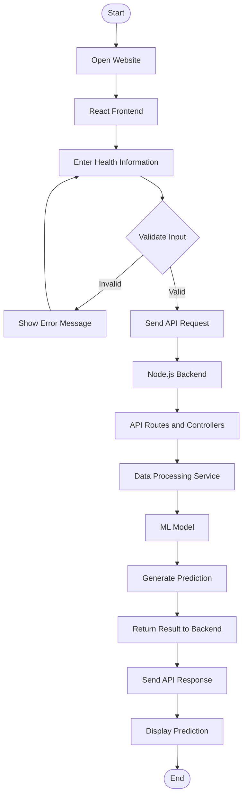
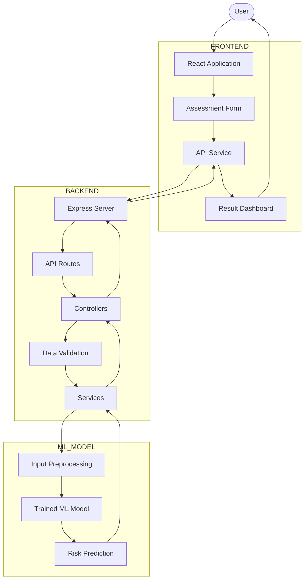

# 🩺 Diabetes Risk Predictor
### AI-Powered Healthcare Risk Assessment Platform

An intelligent full-stack web application that uses Machine Learning to assess the potential risk of diabetes based on user-provided health parameters.

The platform integrates a modern frontend, Node.js backend, and machine learning model to deliver an accessible and user-friendly diabetes risk assessment experience.

## 🌟 Key Features

- Modern and responsive user interface.
- User-friendly health assessment form.
- Machine Learning-based diabetes risk prediction.
- Backend API integration.
- Automated data processing and prediction.
- Result visualization.
- Modular frontend, backend, and ML architecture.

## 🛠️ Technology Stack

| Layer | Technologies |
|---|---|
| Frontend | React.js, JavaScript, HTML, CSS |
| Backend | Node.js, Express.js |
| Machine Learning | Python, Scikit-learn |
| Data Processing | Pandas, NumPy |
| API Communication | REST API |
| Database / Storage | Project-specific data storage |
| Development | VS Code, Git, GitHub |

## 🏗️ Project Architecture

The application consists of three major components:

**1. Frontend**
- Collects user health information.
- Provides an interactive interface.
- Sends prediction requests to the backend.
- Displays prediction results.

**2. Backend**
- Handles API requests.
- Validates incoming user data.
- Manages application logic.
- Communicates with the ML model.
- Returns prediction responses.

**3. Machine Learning**
- Processes diabetes-related datasets.
- Performs data preprocessing.
- Uses a trained classification model.
- Generates prediction results.

## 📁 Project Structure

```text
Diabetes-Risk-Predictor/
│
├── backend/
│   ├── config/
│   ├── controllers/
│   ├── data/
│   │   └── db.json
│   ├── middleware/
│   ├── models/
│   ├── routes/
│   ├── services/
│   ├── .env
│   ├── .gitignore
│   ├── package.json
│   ├── package-lock.json
│   ├── server.js
│   └── test_pipeline.js
│
├── frontend/
│   └── React Application
│
├── ml-model/
│   └── Machine Learning Files
│
├── .vscode/
│
├── .gitignore
├── start_all.bat
└── start_all.ps1
```

## 🔄 Complete Project Workflow

1. User opens the website.
2. Frontend displays the diabetes assessment interface.
3. User enters the required health parameters.
4. Frontend validates the submitted information.
5. Frontend sends an API request to the backend.
6. Backend receives and processes the information.
7. Backend communicates with the machine learning component.
8. ML model processes the input and generates a prediction.
9. Backend receives the prediction result.
10. Frontend displays the result to the user.

## 📊 Application Workflow Flowchart



## 🏛️ System Architecture Flowchart



## 🧠 Machine Learning Workflow

The ML component follows these stages:

1. Dataset Collection
2. Data Cleaning
3. Data Preprocessing
4. Exploratory Data Analysis
5. Feature Selection
6. Model Training
7. Model Evaluation
8. Model Integration
9. Prediction Generation

## ⚙️ Installation and Setup

### 1. Clone Repository

```bash
git clone YOUR_GITHUB_REPOSITORY_URL
```

```bash
cd "college Project"
```

### 2. Backend Setup

```bash
cd backend
npm install
```

Configure the required environment variables in the `.env` file.

Start the backend using the command configured in `package.json`:

```bash
npm start
```

### 3. Frontend Setup

Open another terminal:

```bash
cd frontend
npm install
npm run dev
```

### 4. Machine Learning Setup

Install the Python dependencies required by the ML component.

```bash
cd ml-model
pip install -r requirements.txt
```

Run the appropriate ML application or model entry point according to the project configuration.

### 5. Run the Complete Application

The project root contains two startup scripts:

- `start_all.bat` – Windows batch startup script.
- `start_all.ps1` – PowerShell startup script.

If these scripts are configured to launch all three components, you can start the application from the project root.

PowerShell:

```powershell
.\start_all.ps1
```

Windows CMD:

```cmd
start_all.bat
```

## 🔐 Privacy and Security

- Protect sensitive environment variables.
- Validate user-submitted data.
- Avoid exposing confidential health information.
- Follow secure API development practices.

## 🚀 Future Enhancements

- Improved ML prediction performance.
- User authentication and authorization.
- Personalized health dashboard.
- Prediction history.
- Advanced data visualization.
- Cloud deployment.

## ⚠️ Disclaimer

This project is developed for educational and preliminary health risk assessment purposes. Its predictions are not medical diagnoses and should not replace professional medical advice.

## 🎯 Project Objective

The primary objective is to demonstrate how Full Stack Development and Machine Learning can work together to develop an intelligent healthcare application.

**Built with ❤️ using React.js, Node.js, and Machine Learning.**
